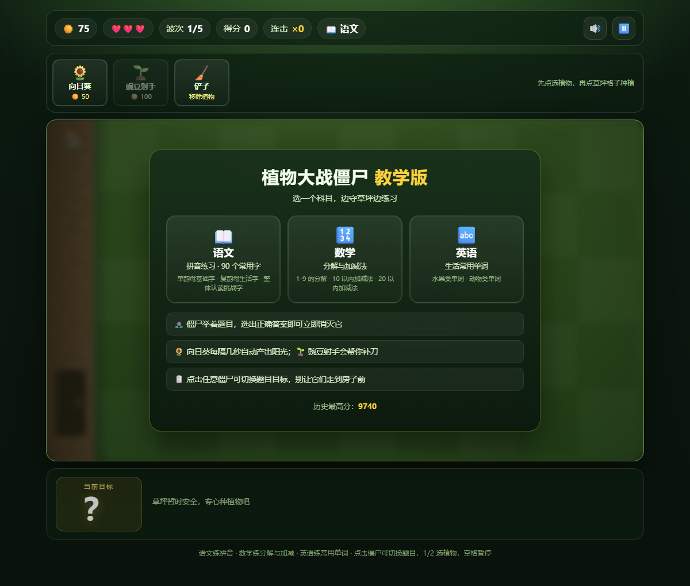
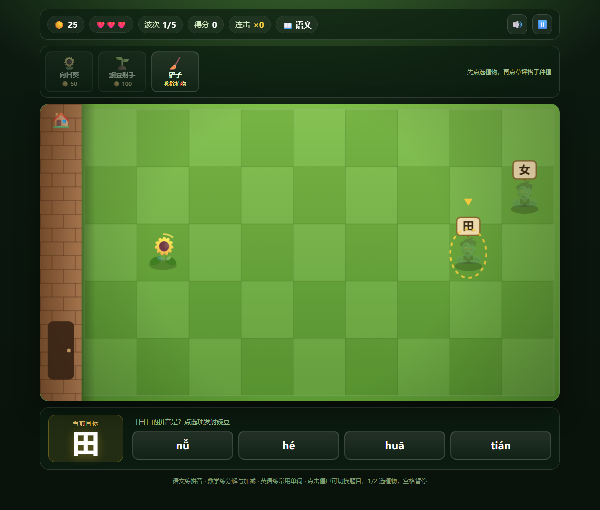
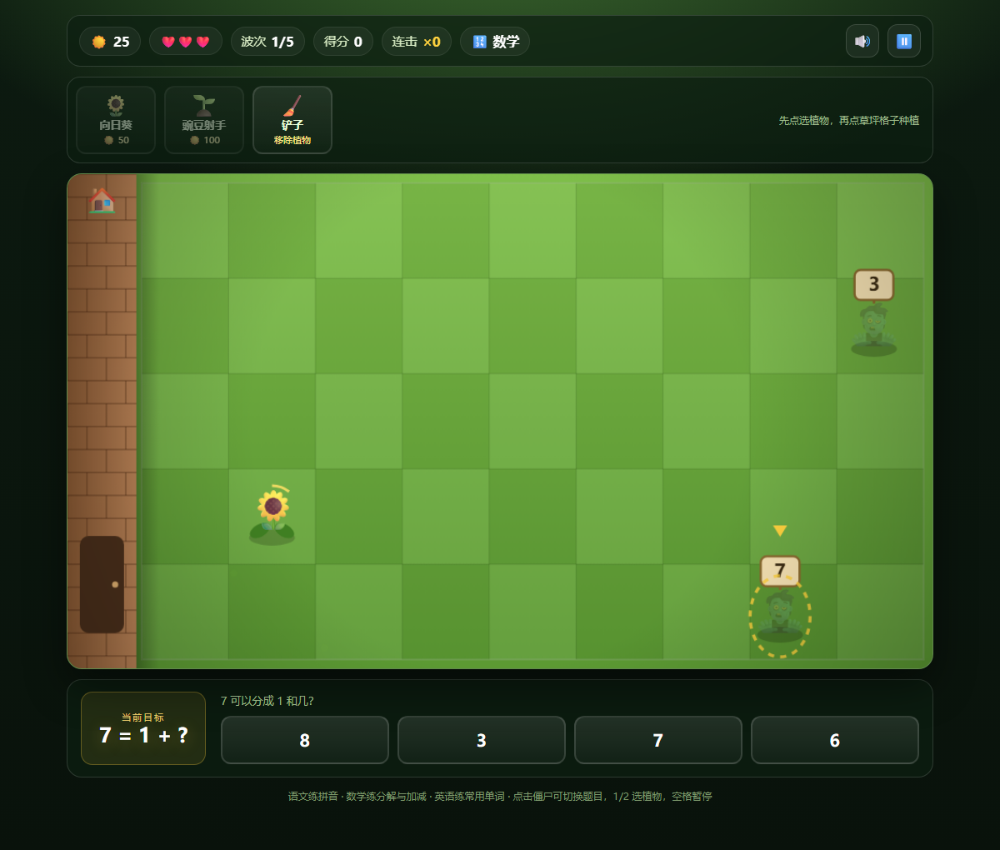
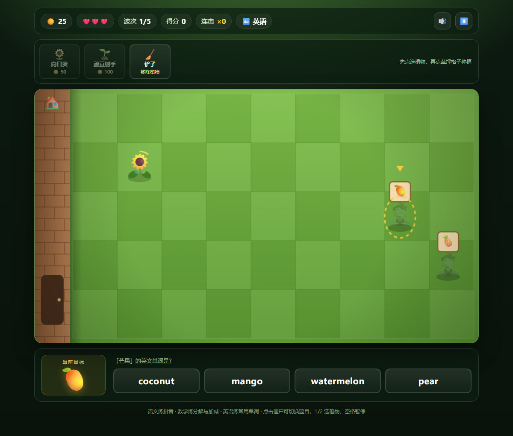

# 植物大战僵尸 · 教学版

用答题打僵尸的塔防学习小游戏：僵尸举着题目进攻，选出正确答案就能秒杀它。内置语文、数学、英语三科，Node 负责服务驱动，HTML + CSS + Canvas 负责页面与动画，另有 Electron 打包的 Windows 单文件桌面版。

## 界面预览

<p align="center">
  
</p>

<p align="center">
  
  
</p>

<p align="center">
  
</p>

## 下载

- **Windows x64 免安装版**：[Release v1.1.0](https://github.com/pref-mail/pingyinWare/releases/tag/v1.1.0) 下载 `PVZ-Teaching-1.1.0-portable.exe`（约 106 MB）
- 双击即可运行，无需安装；首次启动会解压到临时目录，稍慢几秒
- 成绩保存在 `%APPDATA%\pvz-pinyin\data\scores.json`

## 科目与关卡

启动页可选择科目，每局 5 波，三关随波次推进：

| 科目 | 练习内容 | 关卡安排 |
| --- | --- | --- |
| 📖 语文 | 拼音 | 第 1-2 波：单韵母基础字 · 第 3-4 波：复韵母生活字 · 第 5 波：整体认读挑战字 |
| 🔢 数学 | 分解与加减法 | 第 1-2 波：1-9 的分解 · 第 3-4 波：10 以内加减法 · 第 5 波：20 以内加减法 |
| 🔤 英语 | 生活常用单词 | 第 1-3 波：水果类 · 第 4-5 波：动物类 |

语文共 90 个常用字；英语词库含 15 个水果、16 个动物。

## 玩法

1. 选择科目后，僵尸会从右侧沿 5 条草地推进，头顶举着当前题目。
2. 面板弹出选项，**答对**即天降光束秒杀最近的僵尸，并获得得分和阳光。
3. **答错**会扣阳光、重置连击，并让僵尸短暂加速，选项会被禁用。
4. 用阳光种植：🌻 向日葵（50，每 7 秒产 25 阳光）、🌱 豌豆射手（100，自动攻击同排僵尸）。
5. 每局 5 波、3 条命；僵尸走到房子会掉命，漏完即失败，撑过第 5 波通关。

### 操作

| 操作 | 说明 |
| --- | --- |
| 点击植物卡片 → 点击草地格子 | 种植植物 |
| `1` / `2` | 快速选择向日葵 / 豌豆射手 |
| `Esc` / `Space` | 暂停 / 继续 |
| 点击拼音、数字或单词选项 | 作答 |

## 特性

- 三科题库：拼音 90 字、数学按数域自动出题、英语 31 个生活单词
- 数学题程序化生成，同一关每次不重样
- 连击加成：答得越快越准，单题得分越高
- 僵尸分普通、快速、护甲三类，波次越高越强
- 纯程序化音效（WebAudio），无外部素材依赖
- 成绩榜保存在服务端，重启不丢失

## 本地运行

```bash
# 纯网页模式（零运行时依赖，Node >= 16）
npm start
# 打开 http://localhost:3000

# 桌面窗口模式
npm install
npm run electron
```

## 打包 Windows exe

```bash
npm install
npm run build:exe
```

产物输出到 `dist/PVZ-Teaching-1.1.0-portable.exe`。

国内网络建议先设置镜像：

```bash
export ELECTRON_MIRROR=https://npmmirror.com/mirrors/electron/
export ELECTRON_BUILDER_BINARIES_MIRROR=https://npmmirror.com/mirrors/electron-builder-binaries/
```

如果 Windows 上遇到 `EBUSY` / `EPERM`（搜索索引器占用了中间目录），可把输出目录指到工作区外：

```bash
npx electron-builder --win portable --config.directories.output=../pvz-build
```

## 目录结构

```
.
├── server.js           # 零依赖 HTTP 服务：静态资源 + 题库/成绩 API
├── electron/main.js    # Electron 主进程：内嵌服务、窗口、单实例锁
├── public/
│   ├── index.html      # 页面结构（HUD、种子栏、答题面板）
│   ├── style.css       # 深绿玻璃拟态主题 + 响应式
│   └── game.js         # 游戏循环、三科出题、僵尸/植物/渲染/音效
├── data/
│   ├── words.json      # 语文 3 关 × 30 词
│   └── english.json    # 英语水果类 / 动物类词库
├── docs/screenshots/   # README 展示截图
└── package.json        # 脚本与 electron-builder 配置
```

## 接口

| 方法 | 路径 | 说明 |
| --- | --- | --- |
| GET | `/api/health` | 健康检查 |
| GET | `/api/words` | 返回语文关卡词库 |
| GET | `/api/english` | 返回英语分类词库 |
| GET | `/api/scores` | 返回最高分与成绩列表（前 10） |
| POST | `/api/score` | 提交成绩 `{ "score": 1234, "waves": 5 }` |

## 词库格式

语文 `data/words.json`：`char` 为汉字，`pinyin` 为带声调标准答案。

```json
{
  "levels": [
    {
      "id": 1,
      "name": "第一关 · 单韵母基础字",
      "words": [{ "char": "爸", "pinyin": "bà" }]
    }
  ]
}
```

英语 `data/english.json`：`zh` 为中文提示，`word` 为正确英文选项，`emoji` 显示在僵尸牌上。

```json
{
  "categories": [
    {
      "id": "fruit",
      "name": "水果类",
      "words": [{ "emoji": "🍎", "zh": "苹果", "word": "apple" }]
    }
  ]
}
```

数学题不需要词库，由 `game.js` 按关卡数域随机生成。

## 技术栈

- **服务端**：Node.js 内置 `http` / `fs` / `path`，零第三方运行时依赖
- **前端**：原生 HTML / CSS / JavaScript，Canvas 2D 游戏循环，WebAudio 程序化音效
- **桌面版**：Electron 45 + electron-builder 26（portable 单文件）
- **数据**：JSON 词库与成绩文件，原子写入

## 声明

本项目为个人学习与亲子练习用途的非官方作品，与 EA / PopCap 官方无关；不使用任何原作美术、音频素材。
